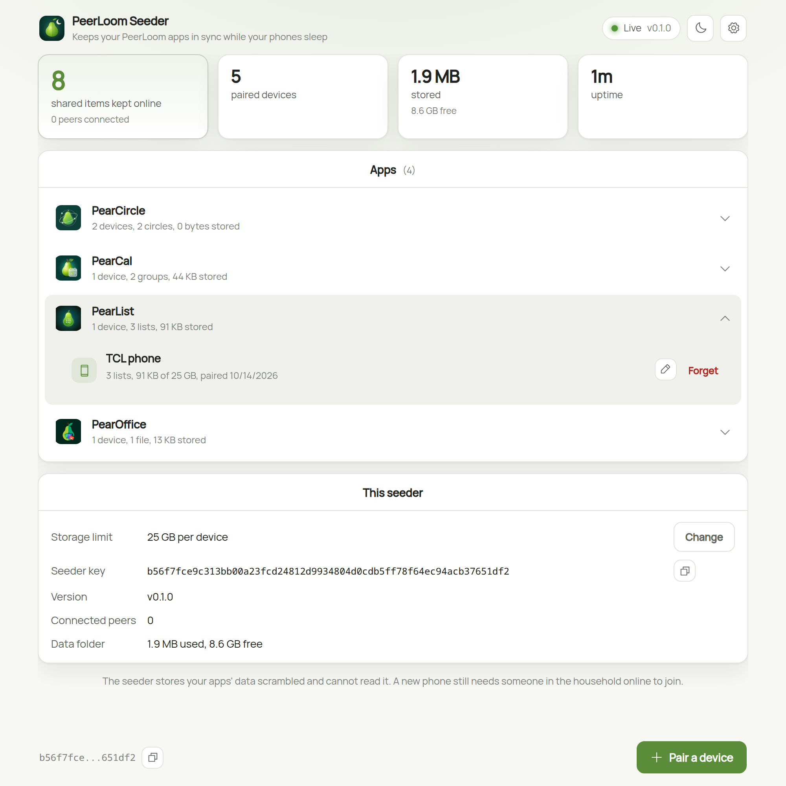
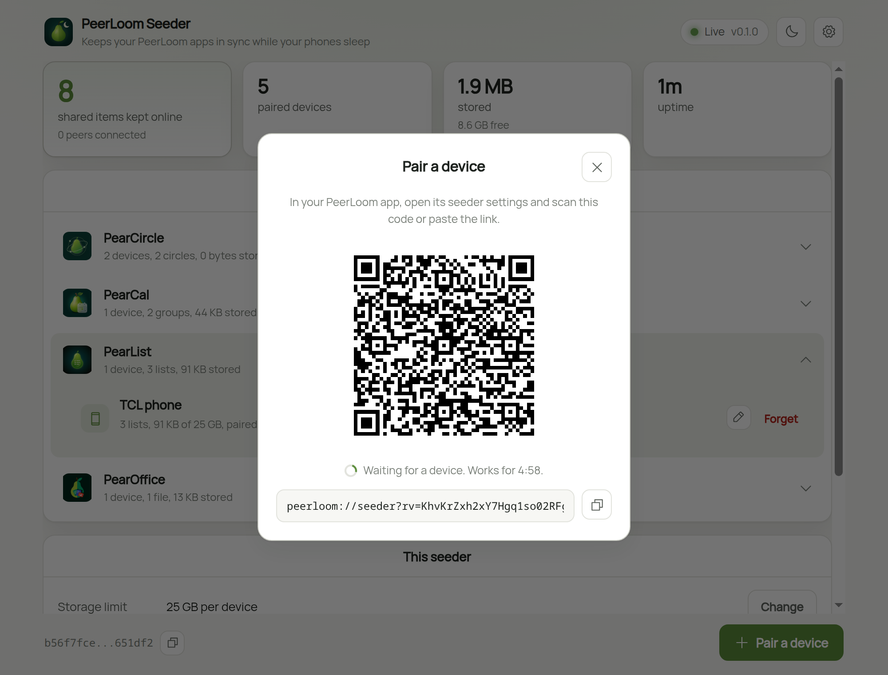

# @peerloom/seeder

One blind seeder for every PeerLoom app. An always-on box stores the encrypted
data of the spaces its paired devices register, and serves it to the other
members, so a space still syncs when everyone else is offline. It never gets a
space's encryption key and does not know which app a space belongs to.

<table>
<tr>
<td width="50%"><picture><source media="(prefers-color-scheme: dark)" srcset="docs/img/dashboard-dark.png"></picture></td>
<td width="50%"><picture><source media="(prefers-color-scheme: dark)" srcset="docs/img/pair-dark.png"></picture></td>
</tr>
<tr>
<td><em>Every app's devices and what they store.</em></td>
<td><em>Pairing: scan the code from the app, or paste the link.</em></td>
</tr>
</table>

**To install PeerLoom Seeder**, get it for Mac, Windows or Linux from
[Releases](https://github.com/peerloomllc/peerloom-seeder/releases/latest), or
on Umbrel and StartOS. Setup steps: <https://peerloomllc.com/seeder/support>.

Built on Holepunch's [`blind-peer`](https://github.com/holepunchto/blind-peer).
First built as PearOffice's seeder. The plan is in the suite root,
`proposals/2026-10-12-generic-seeder.md`.

## What it adds to blind-peer

- **Pairing.** The seeder shows a 5-minute link and QR code. A device that
  opens it proves its swarm key and is trusted from then on.
- **Admission.** Stock blind-peer stores anything for anyone. This one stores
  cores only from paired devices, plus cores from other members of a space a
  paired device registered.
- **A storage limit per device**, set by whoever runs the seeder. Over it, a
  device cannot register new spaces.
- **Drops.** A paired device can ask for a space to be deleted after a delay
  (at most 30 days) or cancel that. Forgetting a device drops, after 7 days,
  every space no other paired device registered.
- **Retention.** A device that backs a space up can ask for only the last N
  days to be kept (`{ t: 'retain', bootstrap, days }`, `days: null` keeps
  everything). Once an hour the seeder notes each core's length and clears
  the blocks it held more than N days ago, moving blind-peer's cleared count
  so they are not fetched again. A member offline longer than N days cannot
  catch up on those blocks from the seeder alone. PearCircle uses it for
  location history.
- **Keyrings.** A small sealed record per person, so a device restored from a
  recovery phrase can find its spaces again. Optional.
- **App labels.** A device can send a label ("PearList") for the dashboard,
  which groups devices by it. Apps for sensitive data send none. The person
  running the seeder can also give a device a name (`setDeviceName`).

## Use

The box:

```js
const { createSeeder } = require('@peerloom/seeder')
const seeder = await createSeeder({ dataDir, log: console.log })
const { link } = seeder.openPairing()   // show as text and QR
await seeder.devices()                  // paired devices, labels, bytes used
await seeder.setDeviceLimit(10e9)       // or null for no limit
await seeder.forgetDevice(deviceKey)
```

A phone:

```js
const { pair, createPeering, createAsker } = require('@peerloom/seeder')
const { seederKey } = await pair({ swarm, link, app: 'PearList' })
const peering = createPeering({ dht: swarm.dht, store, keyPair: swarm.keyPair })
peering.addAutobaseBackground(base, { keys: [seederKey], pick: 1 })
const { ask } = createAsker({ dht: () => swarm.dht, keyPair: swarm.keyPair })
await ask(seederKey, { t: 'drop', bootstrap, afterMs })
```

The app decides which spaces go to which seeders. The phone sends every
writer and view core of an Autobase (blind-peering's `addAutobase` reads the
system core, which the seeder cannot), and must send them again when a writer
joins.

## What it cannot do

- Admit a new member. Adding a writer needs a member online.
- Read anything. Its operator can see how many spaces a device has, how big
  they are, when they change and the IP addresses that send them.

## Consuming it

Dependencies are peers. Apps that bundle for Bare should copy `src/` in with a
vendor script (PearOffice: `scripts/vendor-peerloom-seeder.js`) rather than
use a `file:` dependency, so the bundle has one copy of hypercore and each
native addon.

## Protocol names

`peerloom://seeder` links, `peerloom/seeder-pair/1` and `peerloom/seeder/1`.
The seeder also answers PearOffice's older names (`pearoffice://seeder`,
`pearoffice/seeder-pair/1`, `pearoffice/seeder/1`), so PearOffice versions from
before the shared seeder keep working. `src/protocol.js` has the exchange.

## PeerLoom Seeder (the product)

The seeder people install: one package for Umbrel, Start9, Linux, macOS and
Windows (plan: suite `proposals/2026-10-12-peerloom-seeder-product.md`).
Two processes:

- **The seeder**, `src/bare.js`, run by the Bare runtime from a `bare-pack`
  bundle, so the native addons and hypercore patches match the apps.
  `node scripts/build-bare.js [platform-arch]` puts the runtime and bundle in
  `dist/<platform>-<arch>/`. With `--ipc` it answers newline JSON
  `{ id, method, args }` on stdio: `status`, `pair`, `devices`,
  `forget { deviceKey }`, `limit { bytes | null }`,
  `label { deviceKey, app }` and `rename { deviceKey, name }`, plus `ready`
  and `log` events.
- **The host**, `host/server.js` (Node): starts the seeder
  (`host/seeder-process.js`) and serves the dashboard (`host/index.html`) on
  port 8761: pairing link and QR code, one expandable section per app
  (devices grouped by the app name they sent at pairing, with spaces and
  bytes; devices that sent none under "Other devices"), naming a device,
  forget, the storage limit, the seeder key, version, peers and disk use. Login is `@peerloom/host`'s dashboard-auth,
  copied into `host/vendor/` by `node scripts/vendor-peerloom-host.js`: none
  on 127.0.0.1, `SEEDER_PASSWORD` or a generated password elsewhere.
  Settings are environment variables, listed at the top of the file.

A new data folder starts with a storage limit of 25 GB per device. A folder
a PearOffice seeder set up (`pearoffice-state/`) opens as is: same seeder
key, devices and files, and no limit added.

`npm run dashboard` builds and runs it with data in `~/.peerloom-seeder`.

### Packages

`scripts/stage.js <platform-arch> <dir> [--node]` lays out what every
package carries: `bare` and `seeder/` (the bundle and its addons, plus
libatomic on Linux), `host/server.js` (the host as one esbuild file, with
the page and icon), optionally a pinned Node, the licences and
`THIRD-PARTY-NOTICES.txt`.

- **Linux download:** `npm run dist:linux` builds
  `dist/pkg/peerloom-seeder-<version>-linux-{x64,arm64}.tar.gz` with a
  `.sha256` each, from `packaging/linux/` (launcher with `install-service`,
  `remove-service` and `update`, a systemd user unit, README), then unpacks
  the x64 one and checks it starts, answers and updates against a fake
  local release (`scripts/serve-local-release.js`).
- **Linux installers:** `npm run dist:installers` builds
  `peerloom-seeder_<version>_{amd64,arm64}.deb` and
  `PeerLoomSeeder-<version>-{x86_64,aarch64}.AppImage` (with `.sha256`)
  from the same payload and `packaging/linux/`. The .deb installs to
  `/opt/peerloom-seeder`, starts a systemd user service for the installing
  user and adds a polkit rule so `peerloom-seeder update` installs the next
  .deb without a password (`updater-helper.sh` checks the checksum again).
  The AppImage sets up the same service when first opened from the desktop.
  The build installs the x64 .deb with apt in a Debian 12 container (podman)
  and runs both, checking each one's update path.
- **macOS:** `npm run dist:macos` builds
  `PeerLoomSeeder-<version>-{arm64,x64}.pkg` (with `.sha256`). It stages
  each payload here and signs, packages and notarizes on the Mac Mini over
  ssh (`packaging/macos/build-pkg.sh`, Developer ID identities and the
  `pearcircle-seeder-notary` profile in `buildkey.keychain`; empty
  `APP_SIGN_ID`/`PKG_SIGN_ID` build an unsigned test package). The package
  installs to `/usr/local/lib/peerloom-seeder` and runs the seeder as a
  system LaunchDaemon (`com.peerloomllc.seeder`) as the installing user, so
  it keeps running with nobody logged in. Data is in
  `~/Library/Application Support/PeerLoom Seeder`. It adds "PeerLoom Seeder"
  (opens the dashboard) and "Uninstall PeerLoom Seeder" to Applications.
- **Windows:** `npm run dist:windows` builds `PeerLoomSeeder-Setup-<version>.exe`
  (x64, unsigned, with `.sha256`) with makensis from
  `packaging/windows/installer.nsi`. It installs to Program Files, runs the
  seeder as a service through NSSM (LocalSystem, data in
  `%ProgramData%\PeerLoom Seeder`), allows the seeder through the firewall
  and adds a Start menu link to the dashboard. Running a newer installer over
  it, also with `/S`, keeps the data.
- **Updates (macOS, Windows):** the dashboard checks this repo's releases
  hourly (`host/updates.js`, through @peerloom/host's `update-check` and
  `update-apply`, vendored) and shows "PeerLoom Seeder X is out" with
  **Update now**. It downloads this machine's installer and checks it against
  its `.sha256`. Windows runs the installer silently, which stops the
  service, replaces the files and starts it again. On macOS the seeder runs
  as a person and cannot install, so it drops a request in
  `/Library/Application Support/PeerLoom Seeder/updates/requests` (writable
  by that user only) for a root LaunchDaemon (`com.peerloomllc.seeder.updater`,
  `packaging/macos/updater-helper.sh`) that checks the checksum, the
  Developer ID team, notarization and that the version is newer before
  installing. On Linux the bar says to run `peerloom-seeder update`; in a
  container there is no check. `SEEDER_UPDATE_LATEST_URL` points it at a
  local release (`scripts/serve-local-release.js`) for testing.
- **Start9:** `packaging/start9/` is the StartOS 0.4 package (id
  `peerloom-seeder`, x86_64), from PearOffice's `start9/seeder`. It runs the
  Umbrel image (build it first with `ARCHS=amd64`), asks for a dashboard
  password (the **Show password** action) and has no update check. Build with
  `npm install && make` there; see its README.
- **Umbrel / Docker:** `npm run image` builds
  `ghcr.io/peerloomllc/peerloom-seeder:<version>` for amd64 and arm64 from
  `packaging/umbrel/Dockerfile` (`PUSH=1` pushes, `ARCHS=amd64` builds one).
  It must run with host networking. `packaging/umbrel/` also holds the store
  entry (`umbrel-app.yml`, `docker-compose.yml`; the release fills in
  `VERSION` and `DIGEST`). The id `peerloom-seeder` fits both PeerLoom's
  community store and the official one.
### Release

`./scripts/release.sh [vX.Y.Z]` (the non-phone profile of
`../RELEASE-PIPELINE.md`, modelled on PearOffice's): version bump
(`scripts/release/bump.js`: package.json, the StartOS image tag and version
graph), `npm test`, release notes, every package above, then the tag on this
repo, the GitHub release with `.sha256` files (`RELEASES_REPO` in
`scripts/app.conf`), the
image on ghcr, a PeerLoom community store PR (the first release adds the
app), the official Umbrel store bump once listed, the StartOS registry PR on
the website and a Nostr note (needs `SIGN_WITH` in `scripts/.env`). Each
publish step asks first; `--skip-<target>` leaves one out.

Branding is in `assets/`: `icon.svg` (exported by `scripts/icons.sh`) and
`listing.md` (store and website copy).

## Run one from Node

`node bin/peerloom-seeder.js --data <folder>` prints a pairing link and takes
`pair`, `status`, `devices`, `limit <bytes|off>` and `forget <key>` on stdin.
For development; the product runs the Bare build.

## Test

`npm test` builds the Bare bundle, then runs, over a local DHT testnet:
the library (pairing under both names, labels, admission, requests, the
storage limit and forgetting), the Bare seeder over `--ipc` (every method,
the 25 GB default, a PearOffice folder opening as is) and the dashboard host
(login and every API route, with a device pairing from its link).
